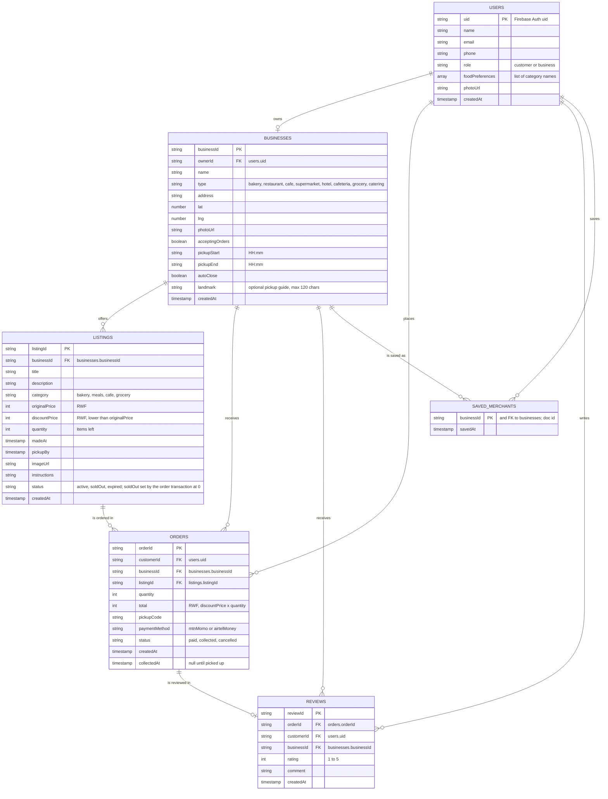

# SokoSafi database (ERD)

Cloud Firestore, six collections. Field names below are exactly the names
stored in Firestore. Every primary key is the document id, not a field.

`SAVED_MERCHANTS` is the subcollection `users/{uid}/savedMerchants`, so each
saved merchant belongs to the user whose document it sits under.

## Relationships

| From | To | Cardinality | Stored as |
|---|---|---|---|
| users | businesses | one user owns zero or one business | `businesses.ownerId` |
| businesses | listings | one business has many listings | `listings.businessId` |
| listings | orders | one listing has many orders | `orders.listingId` |
| users | orders | one customer places many orders | `orders.customerId` |
| businesses | orders | one business receives many orders | `orders.businessId` |
| orders | reviews | one order has zero or one review | `reviews.orderId` |
| users | reviews | one customer writes many reviews | `reviews.customerId` |
| businesses | reviews | one business receives many reviews | `reviews.businessId` |
| users | savedMerchants | one user saves many businesses | subcollection path |

## No duplicated data

- A listing stores only `businessId`; the business name, address and photo
  are read from `businesses`.
- Dashboard numbers, analytics and profile stats (orders today, revenue,
  food rescued, average rating) are calculated from `orders` and `reviews`
  when shown, never stored as totals.
- `orders.businessId` is the one deliberate exception to "only store what
  you cannot look up": it is a foreign key (an id, not a copy of business
  data) so a business can query its orders without reading every listing,
  and so security rules can check ownership directly.
- The users `role` only decides which screens open. Ownership of a business
  is always checked against `businesses.ownerId`.

## Indexes

Listed in `firestore.indexes.json`.

| Collection | Fields | Used by |
|---|---|---|
| listings | businessId asc, createdAt desc | My listings |
